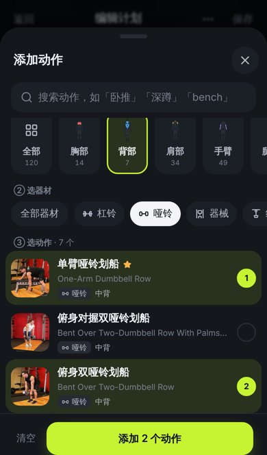
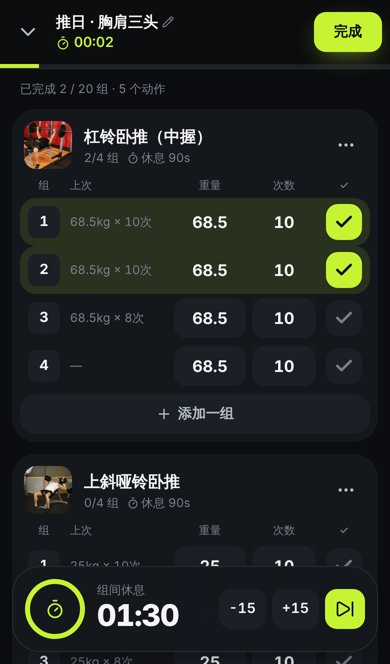
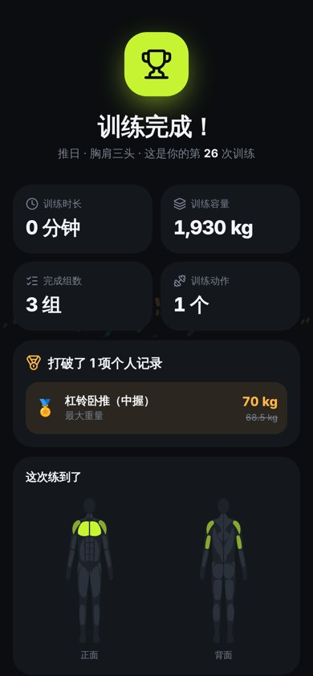
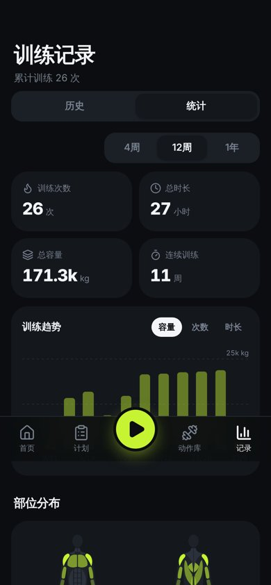
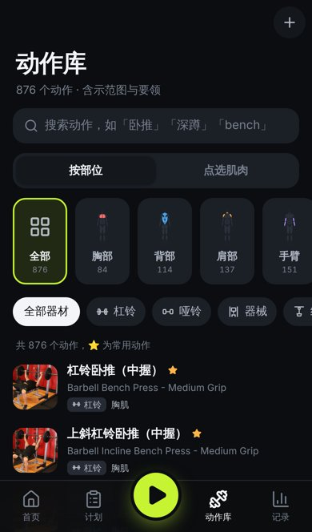

# GymGym 💪 健身记录

一个给自己用的健身记录 App：**制定计划 → 记录每一组 → 回顾进步**。移动端优先的 PWA，可以「添加到主屏幕」像原生 App 一样使用，数据只保存在本机。

<p>
     
</p>

## 功能

- **动作库**：876 个动作（开源 free-exercise-db），全部中文名，带两帧示范图、目标肌群和动作要领；按部位 / 器材 / 关键词筛选，或直接在人体肌肉图上点选；支持自定义动作。
- **训练计划**：选部位 → 选器材 → 选动作，设置组数、次数、重量、组间休息和训练日；5 套推荐模板一键创建。
- **训练记录**：逐组记录重量 × 次数 / 时长 / 距离，自动带出上次数据，一键完成；热身 / 递减 / 力竭组；自动组间休息倒计时（振动 + 提示音）；屏幕常亮；刷新不丢。
- **训练总结**：时长、容量、组数、个人记录（PR）提醒、练到的肌肉、感受打分。
- **记录与统计**：月历历史、训练详情、再练一次、趋势图、部位分布、个人记录、单动作进步曲线、体重曲线。
- **其他**：深色 / 浅色主题、kg / lb、JSON 备份导出导入、离线可用。

设计文档：[产品需求 PRD](docs/PRD.md) · [交互与视觉设计](docs/interaction-design.md)

## 开发

```bash
npm install
npm run dev        # 本地开发 http://localhost:5173
npm run build      # 产物在 dist/
npm run data       # 从 data-src/ 重新生成 public/data/exercises.json
```

技术栈：React 19 · TypeScript · Vite · Tailwind CSS v4 · Dexie（IndexedDB）· Zustand · vite-plugin-pwa · Lucide 图标 · 自绘 SVG 人体肌肉图与图表。

## 部署

仓库自带 GitHub Pages 工作流（`.github/workflows/deploy.yml`）：在仓库 Settings → Pages 把 Source 设为 **GitHub Actions**，推送到 `main` 后自动部署。也可以把 `dist/` 放到任何静态托管（Vercel、Netlify、Cloudflare Pages）。手机浏览器打开后选择「添加到主屏幕」即可。

## 致谢

- 动作数据与示范图：[yuhonas/free-exercise-db](https://github.com/yuhonas/free-exercise-db)（Unlicense）。中文名称由本项目翻译，见 `scripts/zh-names.txt`。
- 图标：[Lucide](https://lucide.dev)（ISC）。
